# Project_template

Это шаблон для решения проектной работы. Структура этого файла повторяет структуру заданий. Заполняйте его по мере работы над решением.

# Задание 1. Анализ и планирование

### 1. Описание функциональности монолитного приложения

У приложения 100 веб-клиентов, к системе подключены 100 модулей управления отоплением

**Управление отоплением:**

- Вероятно, пользователи могут удалённо включать и выключать отопление и задавать значение: в API это `PATCH /api/v1/sensors/:id/value` с полями `value` и `status` (фактически эта операция только записывает значение и статус в таблицу `sensors`: команда на устройство не отправляется, а при следующем чтении значение и статус подменяются данными, полученными от датчика. То есть, исходя из доступного кода, заданное пользователем состояние до устройства не доходит и через API не видно, не совсем понятно как это должно было работать).

**Мониторинг температуры:**

- Пользователи могут просматривать текущую температуру в доме через веб-интерфейс: по конкретному датчику, по списку всех датчиков или по названию помещения;
- Система поддерживает регистрацию датчиков вручную через API: создание, изменение, удаление, просмотр (`/api/v1/sensors`). У датчика есть название, тип, помещение, значение, единица измерения и статус;
- Актуальная температура не хранится: при каждом запросе на чтение сервер сам синхронно опрашивает датчик (`GET /temperature/{sensorId}` или `GET /temperature?location=`) и подставляет полученное значение в ответ. В базу это значение не сохраняется, истории измерений нет;
- Датчик сам данные не отправляет: если сервер его не спросил, данных нет.

### 2. Анализ архитектуры монолитного приложения

- **Язык и фреймворк:** Go 1.22, HTTP-фреймворк Gin.
- **База данных:** PostgreSQL 16, драйвер pgx с пулом соединений. Одна таблица `sensors`; сущностей "пользователь", "дом", "устройство" и "тип устройства" нет.
- **Архитектура:** монолит. Обработка HTTP-запросов (`handlers`), бизнес-логика, работа с БД (`db`) и интеграция с датчиками (`services`) находятся в одном приложении и разворачиваются одним бинарником. Слои разделены по пакетам, но логика в основном лежит в обработчиках.
- **Взаимодействие с устройствами:** только синхронное, по HTTP/JSON, инициатор всегда сервер. Адрес датчиков задаётся одной переменной окружения `TEMPERATURE_API_URL`, таймаут запроса 10 секунд. Брокера сообщений, событий и асинхронной обработки нет.
- **Обработка запросов:** при запросе списка датчиков сервер опрашивает каждый температурный датчик последовательно, в цикле. Время ответа растёт с числом датчиков, а один недоступный датчик задерживает весь ответ до таймаута. Ошибка опроса пишется только в лог, пользователь получает устаревшее значение из БД.
- **Безопасность:** аутентификации и авторизации нет, данные разных клиентов не разделены.
- **Конфигурация:** строка подключения к БД, адрес датчиков и порт берутся из переменных окружения.
- **Масштабируемость:** ограничена. Масштабировать можно только всё приложение целиком, отдельно, например, опрос датчиков не масштабируется. Добавление нового типа устройств требует изменения кода монолита.
- **Развёртывание:** приложение и PostgreSQL упакованы в Docker, запускаются через docker-compose. Любое обновление требует пересборки и перезапуска всего приложения, то есть остановки сервиса для всех пользователей.

### 3. Определение доменов и границы контекстов

Домены выделены по шагам DDD: бизнес-сценарии → домены → поддомены → ограниченные контексты (bounded contexts) → карта контекстов (Context Map).

#### 3.1. Бизнес-сценарии целевой системы

1. Пользователь покупает комплект и сам подключает устройство (своё или партнёрское), работающее по стандартному протоколу.
2. Пользователь управляет отоплением, светом и воротами, смотрит камеры.
3. Пользователь видит телеметрию: текущие значения и историю.
4. Пользователь программирует сценарии, например, если температура ниже 18 °C, то включить котёл.
5. Система работает в режиме самообслуживания в нескольких регионах (у пользователя может быть несколько домов).
6. Новые, пока неизвестные типы устройств подключаются без переделки системы.

#### 3.2. As-Is

В монолите один контекст на всё. Его модель состоит из одной сущности `sensor`, которая одновременно описывает устройство, хранит его последнее значение и статус. Границы будущих контекстов в ней смешаны.

#### 3.3. To-Be

| Домен | Поддомен | Ограниченный контекст | Ответственность и ключевые термины |
|---|---|---|---|
| **Управление устройствами** (платформа) | Каталог и подключение | **Device Registry** | Device, DeviceType (описание возможностей: "переключатель", "уровень", "датчик"), Module, серийный номер, привязка к дому, самостоятельное подключение |
| | Состояние и команды | **Device Control** | Command, желаемое и фактическое состояние устройства, подтверждение доставки команды |
| | Связь с устройствами | **Device Gateway** | адаптеры протоколов партнёров (MQTT, HTTP, Zigbee-хаб и др.); антикоррупционный слой между протоколами устройств и внутренней моделью |
| **Функции умного дома** | Климат | **Heating** | целевая температура, режим (комфорт / эконом / выключено), расписание, гистерезис |
| | Освещение | **Lighting** | включение и выключение, яркость, группы ламп |
| | Доступ на территорию | **Gates** | открыть / закрыть, проверка препятствия, журнал проездов |
| | Наблюдение | **Video** | камера, видеопоток, запись; в MVP – интеграция с внешним видеосервисом |
| **Телеметрия** | Сбор и история | **Telemetry** | Measurement (значение и единица измерения – объект-значение), временной ряд, агрегаты |
| **Автоматизация** | Сценарии | **Scenarios** | Rule = Trigger + Condition + Action, Schedule |
| **Клиенты и доступ** | Пользователи и дома | **Accounts & Homes** | User, House, роль пользователя в доме |
| | Аутентификация | **Identity** | готовое решение (например, Keycloak), токены, сессии |
| **Уведомления** | – | **Notifications** | канал (push / e-mail / SMS), шаблон уведомления |

Принципы разделения:

- **Общая платформа устройств и контексты по видам устройств.** Heating, Lighting, Gates хранят правила своей предметной области и управляют устройствами не напрямую, а через общие команды Device Control. Например, Heating сам решает "включить реле котла", когда температура в комнате опустилась ниже целевой с учётом гистерезиса.
- **Неизвестные устройства** подключаются без новых контекстов: в Device Registry регистрируется новый `DeviceType` с перечнем возможностей, при необходимости в Device Gateway добавляется адаптер протокола. Такое устройство сразу доступно в Device Control, Telemetry и Scenarios. Отдельный контекст появляется, только когда у вида устройств появляются собственные бизнес-правила.
- **Видеонаблюдение** выделено в отдельный контекст: у видео другая природа данных (потоки, большой объём, хранение записей), и его часто берут у внешнего поставщика.
- **За границами системы:** продажа комплектов и биллинг SaaS (будущий домен), производители устройств, внешний видеосервис.

#### 3.4. Карта контекстов

| Откуда → куда | Что передаётся | Тип взаимодействия |
|---|---|---|
| Device Gateway → Telemetry | событие "получено измерение" | асинхронно, через брокер (Pub/Sub) |
| Device Gateway → Device Control | событие "устройство сообщило состояние", подтверждение команды | асинхронно |
| Device Control → Device Gateway | команда устройству | асинхронно |
| Heating / Lighting / Gates / Scenarios → Device Control | команда ("включить", "уровень 60 %") | синхронно REST для приёма команды, результат – событием |
| Telemetry → Heating, Scenarios, Notifications | события измерений | асинхронно, подписка |
| Все контексты → Accounts & Homes | проверка доступа пользователя к дому и устройству | синхронно, REST |
| Device Registry → Device Control, Device Gateway, Telemetry | справочник устройств и типов, событие "устройство подключено" | REST + асинхронное событие |

### **4. Проблемы монолитного решения**

**Технические**

- **Синхронный опрос датчиков сервером.** При каждом запросе списка сервер последовательно опрашивает все температурные датчики с таймаутом 10 секунд на каждый. Время ответа растёт линейно с числом датчиков, один недоступный датчик задерживает весь ответ, а каждый просмотр страницы пользователем порождает запросы к устройствам. При тысячах домов в нескольких регионах такая схема не масштабируется.
- **Управление не доходит до устройства.** Запись значения и статуса меняет только строку в БД: команда устройству не отправляется, подтверждения выполнения и обратной связи нет.
- **Модель данных рассчитана только на один тип устройства.** Сущность `sensor` одновременно описывает устройство, его показание и статус, тип устройства только `temperature`, а все датчики доступны по одному адресу `TEMPERATURE_API_URL`.
- **Развёртывание с остановкой и единая точка отказа.** Любое обновление требует перезапуска всего приложения, а ошибка в любой части останавливает всю систему, включая управление отоплением, что критично в холодное время года.

**Бизнесовые**

- **Нет пользователей, домов, авторизации и разделения данных клиентов.** Модель SaaS с самообслуживанием на текущей системе невозможна. Кроме того, это риск безопасности: любой, кто знает адрес API, может читать и менять данные любых датчиков.
- **Нет самостоятельного подключения устройств.** Каждая установка требует выезда специалиста, а датчики и реле есть только в половине домов, которые хотят подключиться. Расходы и сроки подключения растут вместе с продажами и мешают масштабировать бизнес на несколько регионов.

### 5. Визуализация контекста системы – диаграмма С4

Исходник диаграммы: [schemas/context/as-is-context.puml](schemas/context/as-is-context.puml)

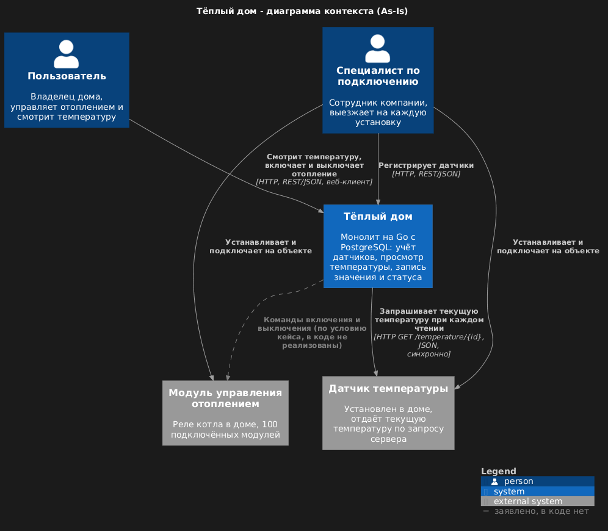

# Задание 2. Проектирование микросервисной архитектуры

**Диаграмма контейнеров (Containers)**

Исходник диаграммы: [schemas/container/to-be-container.puml](schemas/container/to-be-container.puml)

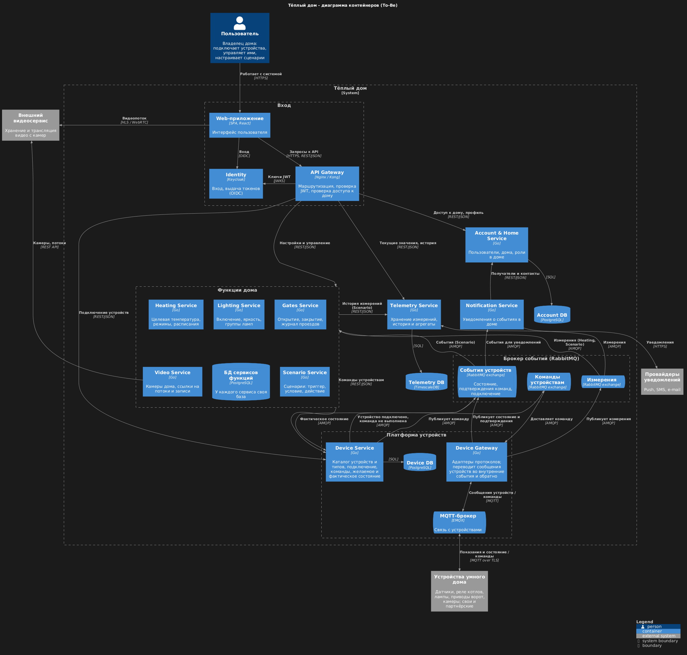

**Диаграмма компонентов (Components)**

Device Service – [исходник](schemas/component/device-service.puml)

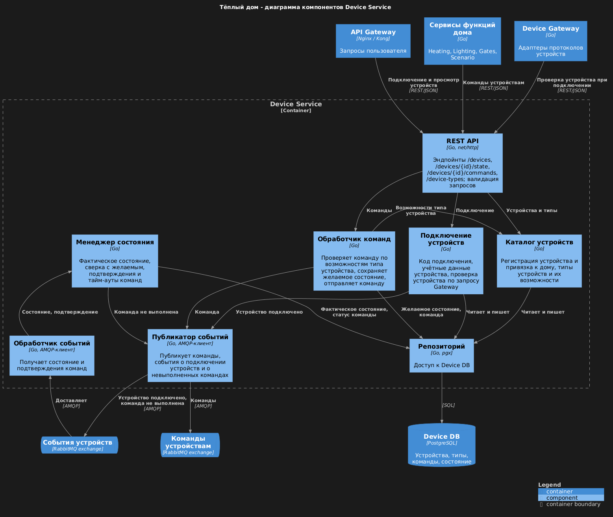

Telemetry Service – [исходник](schemas/component/telemetry-service.puml)

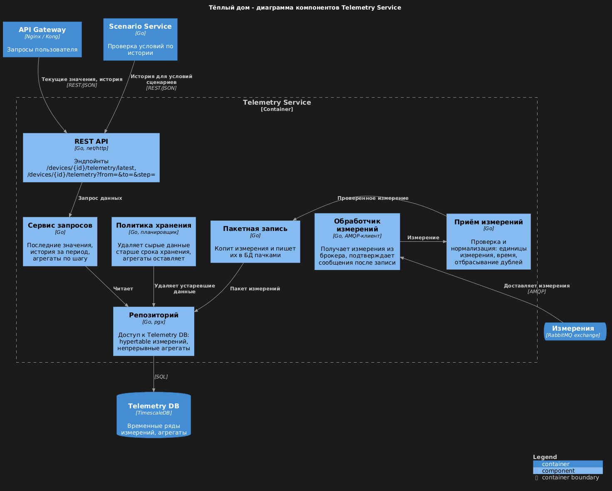

Device Gateway – [исходник](schemas/component/device-gateway.puml)

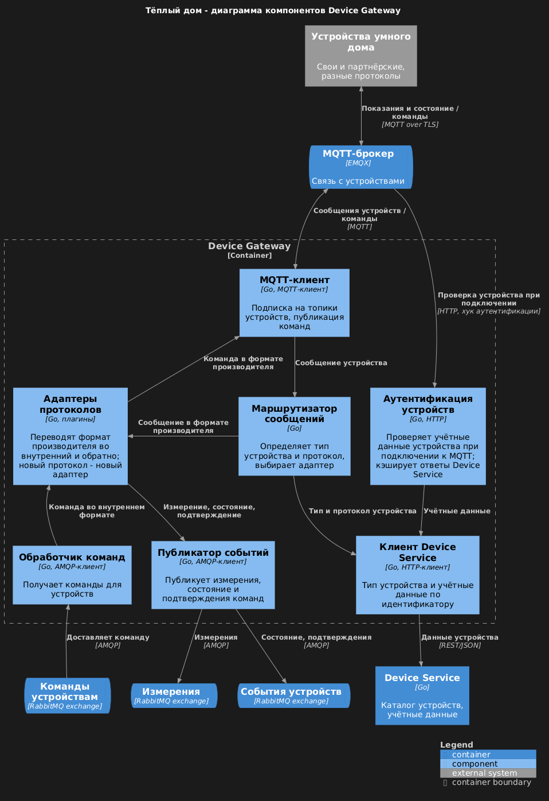

Heating Service – [исходник](schemas/component/heating-service.puml)

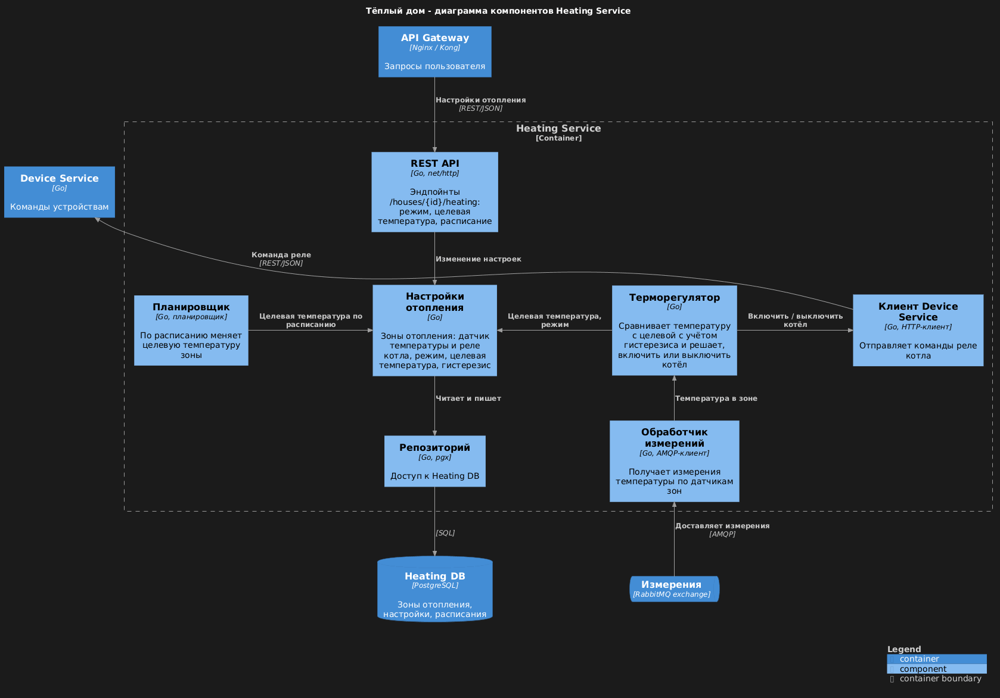

Lighting Service – [исходник](schemas/component/lighting-service.puml)

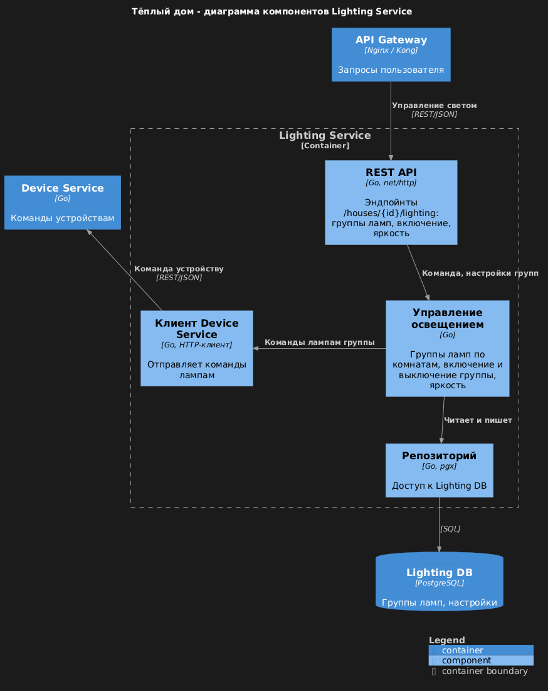

Gates Service – [исходник](schemas/component/gates-service.puml)

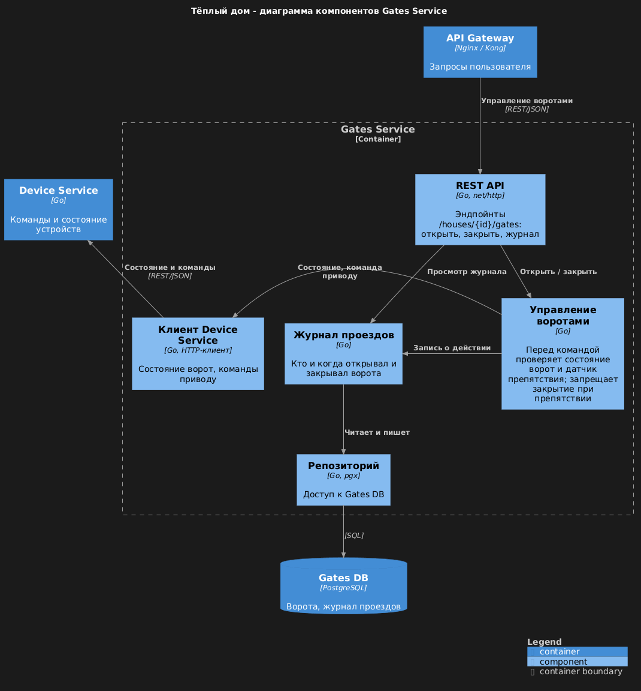

Video Service – [исходник](schemas/component/video-service.puml)

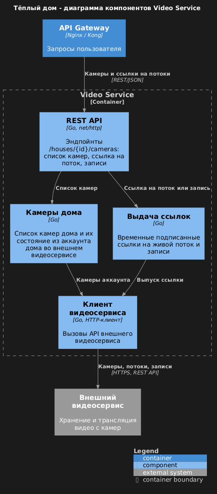

Scenario Service – [исходник](schemas/component/scenario-service.puml)

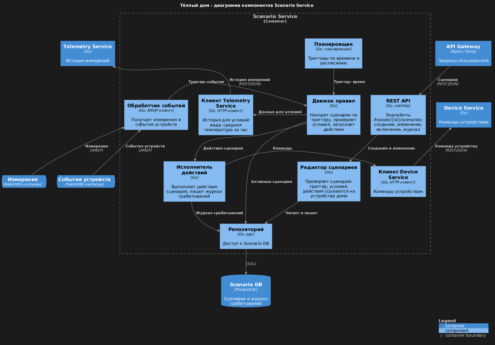

Notification Service – [исходник](schemas/component/notification-service.puml)

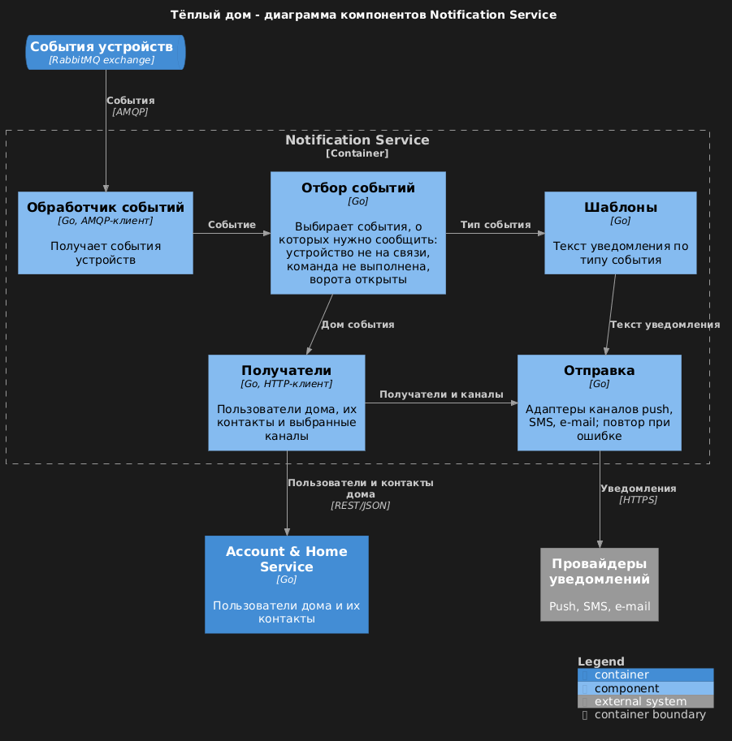

Account & Home Service – [исходник](schemas/component/account-service.puml)

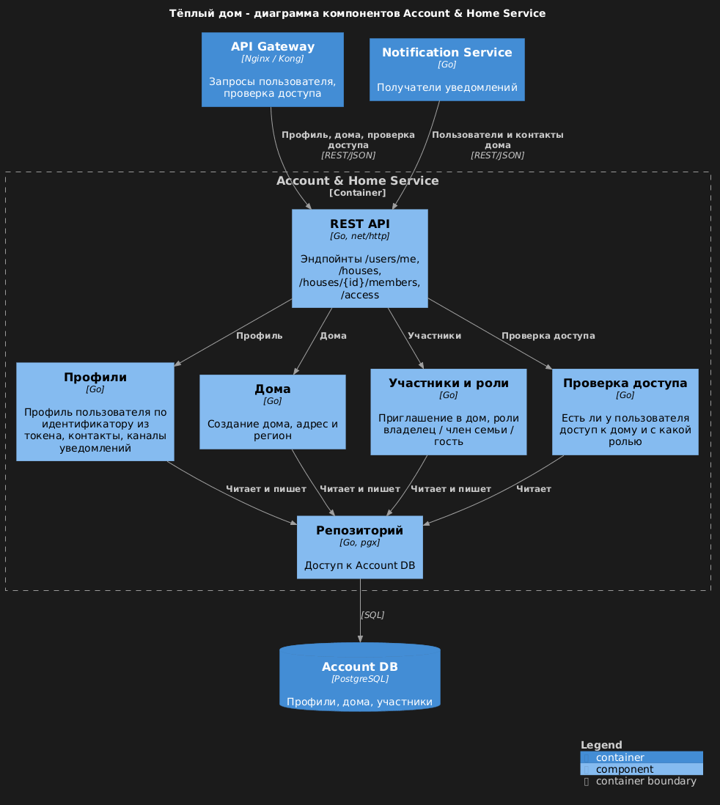

**Диаграмма кода (Code)**

Последовательность "команда устройству" на примере включения котла – самый критичный поток системы: команда проходит через три сервиса и два брокера, а результат возвращается асинхронно. [Исходник](schemas/code/command-sequence.puml)

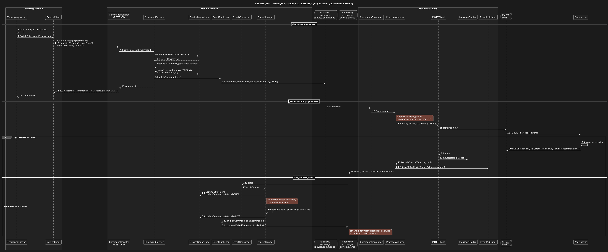

# Задание 3. Разработка ER-диаграммы

Исходник диаграммы: [schemas/er/er-diagram.puml](schemas/er/er-diagram.puml)

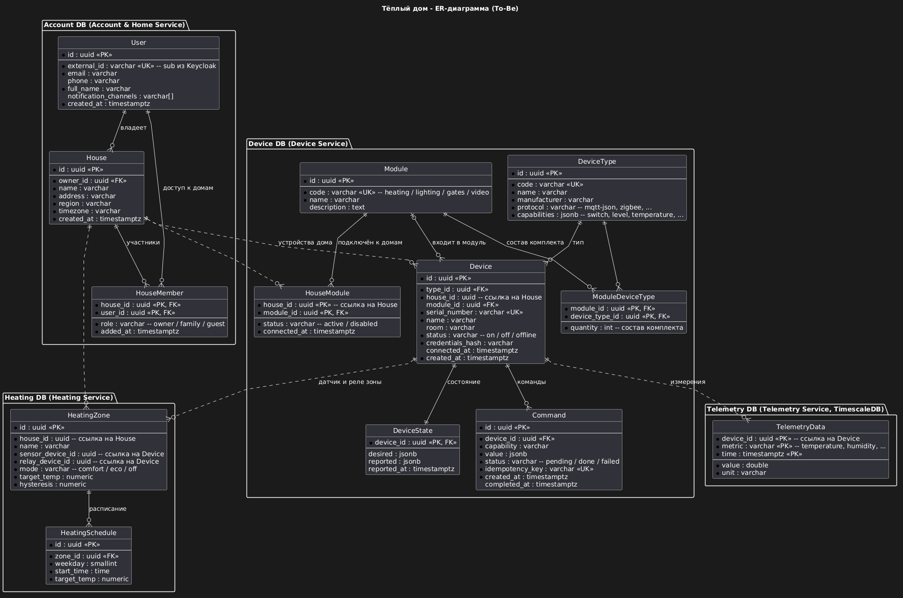

У каждого сервиса своя база, поэтому сущности сгруппированы по БД. Сплошные связи – внешние ключи внутри одной БД, пунктирные – логические ссылки между БД разных сервисов: идентификатор хранится, но внешнего ключа нет, согласованность обеспечивается событиями и проверками в сервисах.

**Сущности**

| БД | Сущность | Назначение |
|---|---|---|
| Account DB | User | Пользователь; `external_id` связывает его с учётной записью в Keycloak |
| | House | Дом пользователя: адрес, регион, часовой пояс |
| | HouseMember | Доступ пользователя к дому и роль: владелец, член семьи, гость |
| Device DB | Module | Модуль умного дома – комплект для одной функции: отопление, освещение, ворота, видео |
| | ModuleDeviceType | Состав комплекта: какие типы устройств и сколько в него входит |
| | HouseModule | Модули, подключённые к дому |
| | DeviceType | Тип устройства: производитель, протокол, возможности (`switch`, `level`, `temperature` и др.) |
| | Device | Устройство в доме: тип, модуль, серийный номер, статус |
| | DeviceState | Желаемое и фактическое состояние устройства |
| | Command | Команда устройству и её статус |
| Telemetry DB | TelemetryData | Измерение: устройство, метрика, время, значение и единица |
| Heating DB | HeatingZone | Зона отопления: датчик температуры, реле котла, режим, целевая температура, гистерезис |
| | HeatingSchedule | Расписание целевой температуры зоны по дням недели |

**Связи**

- **User – House:** один ко многим – пользователь владеет несколькими домами, у каждого дома один владелец (`owner_id`).
- **User – House через HouseMember:** многие ко многим – пользователь может иметь доступ к чужим домам, у дома может быть несколько участников.
- **House – Device:** один ко многим – в доме несколько устройств, каждое устройство принадлежит одному дому.
- **DeviceType – Device:** один ко многим – у каждого устройства один тип.
- **Module – Device:** один ко многим, необязательная – устройство может входить в модуль.
- **Module – DeviceType через ModuleDeviceType:** многие ко многим – состав комплекта.
- **House – Module через HouseModule:** многие ко многим – к дому подключено несколько модулей, один модуль подключён ко многим домам.
- **Device – DeviceState:** один к одному.
- **Device – Command:** один ко многим.
- **Device – TelemetryData:** один ко многим – устройство генерирует множество измерений.
- **House – HeatingZone, HeatingZone – HeatingSchedule:** один ко многим.

Новый тип устройства добавляется записью в `DeviceType` с перечнем возможностей, схема БД при этом не меняется.

# Задание 4. Создание и документирование API

### 1. Тип API

**REST API (OpenAPI)** – для синхронных запросов, когда ответ нужен сразу:

- запросы пользователя через API Gateway: данные устройства, подключение устройства, настройки;
- приём команды от сервисов функций дома (Heating, Lighting, Gates, Scenario) в Device Service: вызывающему нужно сразу узнать, принята ли команда, и получить её идентификатор, либо ошибку – устройство не найдено, тип не поддерживает возможность.

**Асинхронные события через RabbitMQ (AsyncAPI)** – когда ждать ответа не нужно:

- измерения от устройств: поток большой и постоянный, у него несколько подписчиков (Telemetry, Heating, Scenario), и издатель не должен знать о них;
- доставка команд устройству и подтверждения от него: устройство может быть временно не на связи, брокер буферизует сообщения, а отправитель не блокируется;
- события устройств (состояние, подключение, сбой команды): на них реагируют несколько сервисов, включая Notification.

### 2. Документация API

| Спецификация | Что описывает |
|---|---|
| [Device Service – OpenAPI 3.0](schemas/api/device-service.openapi.yaml) | REST API сервиса устройств: 5 эндпойнтов |
| [События устройств – AsyncAPI 3.0](schemas/api/device-events.asyncapi.yaml) | Каналы RabbitMQ: команды, измерения, события устройств |

**Эндпойнты Device Service**

| Метод и путь | Назначение | Коды ответа |
|---|---|---|
| `POST /devices` | Подключить устройство к дому по серийному номеру и коду из комплекта | 201, 400, 401, 403, 409, 500 |
| `GET /devices/{deviceId}` | Получить информацию об устройстве и его текущее состояние | 200, 401, 403, 404, 500 |
| `PUT /devices/{deviceId}/state` | Обновить желаемое состояние устройства по нескольким возможностям | 202, 400, 401, 403, 404, 422, 500 |
| `POST /devices/{deviceId}/commands` | Отправить команду устройству, с ключом идемпотентности | 202, 400, 401, 403, 404, 409, 422, 500 |
| `GET /devices/{deviceId}/commands/{commandId}` | Получить статус команды: `pending` / `done` / `failed` | 200, 401, 403, 404, 500 |

Для каждого эндпойнта в спецификации описаны схемы запроса и ответа и примеры в блоке `examples`.

**Каналы событий**

| Канал (exchange) | Сообщения | Публикует | Получают |
|---|---|---|---|
| `device.commands` | DeviceCommand | Device Service | Device Gateway |
| `device.measurements` | MeasurementReceived | Device Gateway | Telemetry, Heating, Scenario |
| `device.events` | DeviceStateReported, CommandFailed, DeviceConnected | Device Gateway, Device Service | Device Service, Scenario, Notification |

# Задание 5. Работа с docker и docker-compose

**temperature-api** – [apps/temperature-api](apps/temperature-api), имитирует удалённый датчик и отдаёт случайную температуру от 10 до 30 °C:

| Запрос | Кто вызывает |
|---|---|
| `GET /temperature?location=Kitchen` | монолит, `GET /api/v1/sensors/temperature/:location` |
| `GET /temperature/{sensorId}` | монолит, `Get Sensor by ID` и `Get All Sensors` |
| `GET /health` | проверка работоспособности |

Если `location` не передан, он определяется по `sensorId`, и наоборот – по соответствию из условия задания (1 – Living Room, 2 – Bedroom, 3 – Kitchen). Ответ совпадает со структурой `TemperatureResponse` монолита: `value`, `unit`, `timestamp`, `location`, `status`, `sensor_id`, `sensor_type`, `description`. Порт берётся из переменной `PORT`, по умолчанию 8081.

**Dockerfile** – двухэтапная сборка: `golang:1.22-alpine` собирает статический бинарник, `alpine` запускает его от непривилегированного пользователя.

**docker-compose** – [apps/docker-compose.yml](apps/docker-compose.yml):

- `postgres` – PostgreSQL 16, скрипт `./smart_home/init.sql` монтируется в `/docker-entrypoint-initdb.d/` и выполняется при первом запуске на пустом томе; данные хранятся в томе `postgres_data`; `healthcheck` через `pg_isready`, монолит стартует только после него. Переменная `POSTGRES_DB` не задаётся, потому что `init.sql` сам создаёт базу `smarthome`.
- `temperature-api` – порт 8081.
- `app` – монолит на порту 8080, обращается к БД и temperature-api по именам сервисов в сети `smarthome-network`.
- Логины и пароли баз данных и брокера вынесены в [apps/.env](apps/.env), compose подставляет их сам; значения тестовые.

# **Задание 6. Разработка MVP**

В MVP из монолита выделены два микросервиса с простейшей логикой – управление устройствами и телеметрия. Они работают рядом с монолитом и забирают у него часть ответственности; это первый шаг перехода по схеме Strangler Fig.

| Сервис | Язык | Что делает | БД |
|---|---|---|---|
| [device-service](apps/device-service) | Go, `net/http` | Регистрация устройств, команда включения и выключения, опрос датчиков старого образца | PostgreSQL `device-db` |
| [telemetry-service](apps/telemetry-service) | Python, FastAPI | Приём измерений из брокера, последнее значение и история | TimescaleDB `telemetry-db` |
| RabbitMQ | – | Exchange `device.measurements` и `device.commands` (формат сообщений – [AsyncAPI](schemas/api/device-events.asyncapi.yaml)) | – |

Оба языка поддерживают ООП: в Python – классы (`TelemetryRepository`, `MeasurementConsumer`), в Go – структуры с методами и интерфейсы (`DeviceRepository`, `DeviceHandler`, `LegacySensorPoller`, интерфейс `Publisher`).

**Взаимодействие**

```
Postman → монолит ── REST ──► device-service ──► device-db
              │                    │
              │                    ├─ опрос раз в 10 с ──► temperature-api
              ▼                    │
       temperature-api             └─ измерения ──► RabbitMQ ──► telemetry-service ──► telemetry-db
```

1. **Монолит → device-service (REST).** При `Create Sensor` монолит регистрирует датчик как устройство (`POST /api/v1/devices`), при `Update Sensor Value` отправляет команду включения или выключения (`POST /api/v1/devices/{id}/commands`). Вызовы выполняются по возможности: если device-service недоступен, монолит пишет ошибку в лог и продолжает работать. Интеграция включается переменной `DEVICE_SERVICE_URL`.
2. **device-service → RabbitMQ.** Датчики старого образца сами данные не отправляют, поэтому device-service раз в 10 секунд опрашивает их (`GET /temperature/{id}` в temperature-api) и публикует измерения в `device.measurements`. В целевой архитектуре эту роль выполняет Device Gateway. Команды публикуются в `device.commands`; их получателем в целевой архитектуре станет Device Gateway, в MVP его нет.
3. **RabbitMQ → telemetry-service.** Сервис подписан на `device.measurements` через очередь `telemetry.measurements`, сохраняет измерения (повторно доставленное сообщение не создаёт дубль) и отдаёт их по REST.

Монолит по-прежнему сам получает температуру из temperature-api, поэтому проверка задания 5 работает без изменений.

**API новых сервисов**

| Сервис | Метод и путь | Назначение |
|---|---|---|
| device-service, порт 8082 | `POST /api/v1/devices` | Зарегистрировать устройство |
| | `GET /api/v1/devices`, `GET /api/v1/devices/{id}` | Список устройств, устройство |
| | `POST /api/v1/devices/{id}/commands` | Команда `{"capability": "switch", "value": "on" \| "off"}` → `202 Accepted` |
| telemetry-service, порт 8083 | `GET /api/v1/devices/{id}/telemetry/latest` | Последнее измерение |
| | `GET /api/v1/devices/{id}/telemetry?limit=20` | История измерений |

Интерактивная документация telemetry-service генерируется FastAPI: http://localhost:8083/docs. Консоль RabbitMQ: http://localhost:15672 (guest / guest).

**Запуск и проверка**

```bash
cd apps
./init.sh
```

1. В Postman вызвать `Create Sensor` – датчик появится в device-service: `GET http://localhost:8082/api/v1/devices/1`.
2. Через 10–20 секунд появятся измерения: `GET http://localhost:8083/api/v1/devices/1/telemetry?limit=5`.
3. Вызвать `Update Sensor Value` со статусом `inactive` – в device-service статус устройства станет `off`, в логах `docker compose logs device-service` будет опубликованная команда.

**План перехода к целевой архитектуре**

| Шаг | Что переносится | Что меняется в монолите |
|---|---|---|
| 1. MVP (сделано) | Учёт устройств и телеметрия дублируются в новых сервисах | Монолит сообщает device-service о новых датчиках и командах |
| 2 | Чтение температуры | Монолит берёт последнее значение из telemetry-service вместо прямого опроса датчика |
| 3 | Device Gateway с MQTT, самостоятельное подключение устройств | Новые устройства подключаются только через device-service |
| 4 | Heating Service | Управление отоплением уходит из монолита, `PATCH /sensors/:id/value` перенаправляется в Heating Service через API Gateway |
| 5 | Перенос данных и отключение | Датчики из таблицы `sensors` переносятся в device-service, эндпойнты `/api/v1/sensors` отключаются, монолит выводится из эксплуатации |
